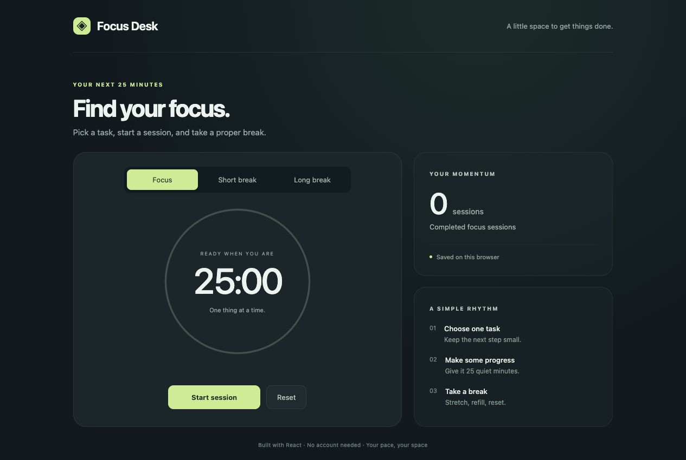

# Focus Desk

A small **React + Vite** focus timer with a calm interface, short and long breaks, and a completed-session counter saved in your browser. A beginner-sized frontend project with real timer state, responsive styling, and tests.



## Run locally

Requires **Node.js 22.12 or newer** and npm.

```bash
git clone https://github.com/Aye-Shun/focus-desk.git
cd focus-desk
npm ci
npm run dev
```

Open the local address printed by Vite, usually `http://127.0.0.1:5173`.

## Features

- 25-minute focus sessions, 5-minute short breaks, and 15-minute long breaks.
- Start, pause, resume, and reset controls.
- A progress ring and remaining time in the browser tab title.
- Completed focus-session count saved in `localStorage` when available.
- Responsive layouts, keyboard-accessible controls, and reduced-motion styling.

When a session finishes, choose the next mode and start it when ready. Changing modes cancels the current timer. Reset returns the selected mode to its full duration; it keeps the completed-session count. Breaks do not count as focus sessions.

## Timer design

`src/timer.js` keeps timer transitions in a pure reducer. Running sessions use an absolute deadline, so delayed browser callbacks do not turn into accumulated countdown drift. Pausing keeps the remaining milliseconds; the display rounds up to whole seconds. Completion can add to the session count only once.

`src/main.jsx` connects the reducer to the controls, periodic ticks, browser visibility changes, and storage. `src/style.css` handles the layout without a component library or external fonts.

## Tests and production build

```bash
npm test
npm run build
npm run preview
```

The tests exercise delayed callbacks, exact pause/resume timing, once-only completion, break counting, mode changes, and display rounding. GitHub Actions tests and builds on Node.js 22 and 24. The build writes static files to `dist/`.

## Scope

This is a single-tab learning app. Refreshing or closing the page resets the active timer; only the completed-session count is saved. Multiple tabs can overwrite that count, so use one tab at a time. Clearing site data removes the count. If storage is blocked, the app shows that sessions will last only for the current visit.

There are no accounts, notifications, sound alerts, cloud sync, task lists, or configurable durations. A sleeping or suspended browser displays the elapsed result when execution resumes. Since deadlines use the system clock, changing that clock can affect a running timer.

Possible extensions: custom durations, session history, and optional completion notifications.

## License

MIT — see [LICENSE](LICENSE).
